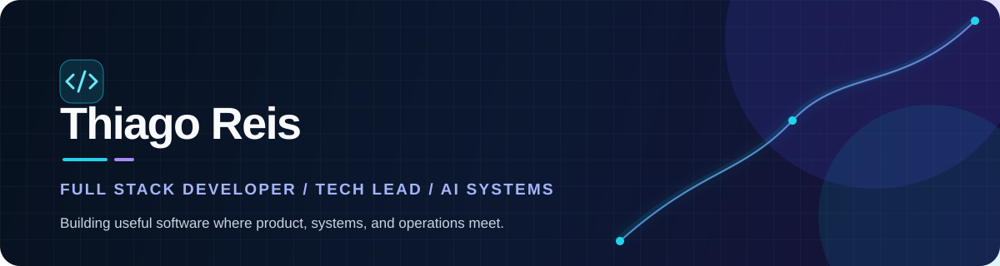

  

  
  

 

## Who I am

I am a Full Stack Developer and Tech Lead who turns operational complexity into useful, dependable software.

I work from the first architecture conversation to production: aligning technical decisions with the actual people, processes, and business outcomes behind a product. My current focus is on web platforms, integrations, automation, and applied AI.

<table>
  <tr>
    <td width="50%">
      <h3>01 — I build</h3>
      Web products, internal platforms, APIs, integrations, and automations that remove friction from real operations.
    </td>
    <td width="50%">
      <h3>02 — I lead</h3>
      Technical decisions with a practical lens: understandable architecture, secure delivery, and systems people can maintain.
    </td>
  </tr>
</table>

## Toolkit

  
  
  
  
  
  

React · TypeScript · Node.js · Python · PostgreSQL · REST APIs · Docker · Cloud · CI/CD · AI integrations

## Engineering principle

> Shipping code is only the beginning. The work is making sure the system remains secure, understandable, and useful after it reaches production.

  
<strong>The emotional lifecycle of shipping software</strong>

   
  

    
  

 

  <strong>Building something that needs product thinking and solid engineering?</strong> 
  <a href="https://www.linkedin.com/in/thiagoafrika/">Let's talk →</a>

